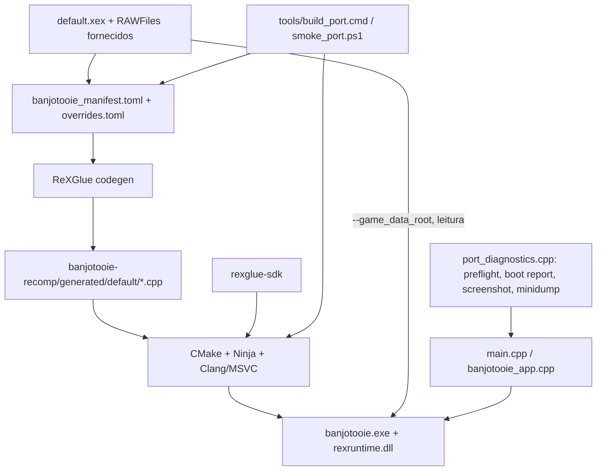

# Missão 00 — Auditoria do estado atual (revisão de 2026-11-10)

**Escopo:** inventário e linha de base do port nativo já existente. Não foram implementadas funcionalidades. Os arquivos do jogo em `W:\Decomp\Banjo 3\Banjo Tooie BR` foram tratados como entrada somente leitura.

## Resumo

O projeto já contém um port nativo Windows x64 baseado em ReXGlue, funções PowerPC recompiladas para C++, um runtime gráfico/serviços de console, scripts de build e smoke tests. O build registrado em `app/_audit/out/m00/build-fresh-20261110` produziu o executável e a DLL; seu log contém 0 erros e 458 avisos. Embora a pasta do executável seja isolada, o linker também escreveu `app/rexglue-sdk/out/win-amd64/rexruntime.dll`; não há hash anterior dessa saída para comparar. Um smoke recente carregou o XEX e capturou uma imagem válida em 1280×720, com guest.frames=2.235 em guest.elapsed_s=75,20 s (~29,7 FPS de média; a última amostra de 1 s foi 29,39 FPS). A tela PT-BR “PRESSIONE START PARA JOGAR” aparece, mas nenhum botão foi enviado: menu, controles durante jogo, saves e jogabilidade não foram comprovados nesta auditoria.

O alvo 4K/60 ainda não foi atingido como evidência: 4K não foi executado e a medição observada foi perto de 30 FPS em 720p. As alterações desta missão incluem este relatório, logs/captura, identidade/fila Understory e a DLL gerada em `app/rexglue-sdk/out/win-amd64/rexruntime.dll`. Nenhum arquivo fonte ou arquivo original do jogo foi alterado; a DLL é um artefato de build sem hash anterior nesta auditoria.

## Raízes, arquivos e ferramenta de build

- **Pasta Craft Anything:** `W:\Decomp\Banjo 3`.
- **Raiz Git e código do aplicativo:** `W:\Decomp\Banjo 3\app`.
- **Dados fornecidos pelo usuário:** `W:\Decomp\Banjo 3\Banjo Tooie BR`.
- **Inventário:** 36 arquivos — 25 PNG, 1 XML e 10 arquivos binários. Incluem `default.xex` (XEX2 PowerPC, 7.413.760 bytes), `RAWFiles\db360.cmp`, `db360.textures.cmp`, `banjo2_360.tbl/.ctl`, strings, fonte Unicode e layouts. Os arquivos obrigatórios e recomendados passaram no preflight. `RAWFiles\db360_TexFileList.txt` está ausente, mas é opcional: o código usa o pacote `db360.textures.cmp`.
- `app/_audit/out/inventory.json` guarda os hashes SHA-256. Após o smoke final, **36/36 hashes continuaram iguais**.
- **Build:** `app/tools/build_port.cmd` usa CMake/Ninja, compila o codegen ReXGlue, gera C++ do XEX e compila `banjotooie.exe` e `rexruntime.dll`. O executável de referência é `app/banjotooie-recomp/out/build/win-amd64-release/banjotooie.exe`.
- **Teste automatizado:** `app/tools/smoke_port.ps1`. O SDK contém testes unitários em `app/rexglue-sdk/tests/unit`, mas o build de produto usa `REXGLUE_BUILD_TESTS=OFF`; esses testes unitários não foram executados nesta missão.
- **Dependências registradas:** `app/docs/evidencias/ferramentas.log` registra Git 2.56, CMake 4.4.0-rc3, Ninja 1.13.2, Python 3.14.6, Java 21, Visual Studio 2022 Build Tools/MSVC 14.44, SDKs Windows 10.0.22621/26100, Vulkan e GPU RTX 5080. O script de build fixa VS 2022 + Clang MSVC e Ninja; o Clang 22 listado no log é a instalação MSYS2 e não é o compilador fixado pelo script.

## Git e comparação da base

- **Checkpoint existente:** branch `missao-02-traducao`, HEAD `f4aaeb0c54b4cf2152c4ba2586894bba424f3e19`; o mesmo commit também aponta `missao-01-port-nativo`.
- **Base local:** `master` em `1075821d0341829aa56b929c4c94949abe0b800b`. HEAD está quatro commits à frente; a diferença versionada contém 33 arquivos, 2.556 inserções e 24 remoções, formando principalmente o port nativo da Missão 01 (build, codegen, harness/diagnóstico, documentação e evidências).
- **Árvore de trabalho já estava suja:** `banjotooie-recomp/src/banjotooie_app.cpp/.h` têm uma mudança de diagnóstico da Missão 02; `_audit/DecompileAt.java`, `_audit/decompile_at.cmd` e `_audit/m02/` são não rastreados. A alteração C++ adiciona `--port_dump_db`; ela não foi criada nem modificada nesta auditoria. O build recente compila a árvore de trabalho atual, incluindo essa alteração preexistente.
- **Sem commit novo:** HEAD existente é o checkpoint seguro. Nenhum arquivo foi adicionado ao índice e nenhuma mudança preexistente foi revertida. `git remote -v` está vazio; não houve acesso Git remoto nesta missão.
- **Referências upstream registradas localmente** em `app/docs/evidencias/upstream_heads.log` (snapshot de 2026-11-09): base iron-jay `72c2397`, fork ReXGlue `035aa25`, ReXGlue oficial `546a082`, além das três variantes XenonRecomp e MC_LA_Recompiled. O fork fixa o runtime que foi validado pela base; XenonRecomp e suas variantes são referências de recompilação, não substitutos diretos do runtime gráfico/serviços. MC_LA_Recompiled serve de referência de produto, mas tem licença GPL-3.0. Como não foi feita consulta remota agora, estes hashes representam o snapshot já guardado, não necessariamente os HEADs de hoje.

## Mapa dos módulos

- `banjotooie-recomp/generated/default` contém o código C++ gerado; o registro da Missão 01 aponta 22.111 funções em cerca de 45 arquivos gerados. Não é código-fonte original escrito à mão.
- `banjotooie-recomp/src` fornece o ponto de entrada Windows, integração ReXGlue e diagnósticos.
- `rexglue-sdk` fornece runtime x64, recompilação PowerPC e serviços gráficos D3D12, áudio, entrada, VFS e armazenamento.
- `overrides.toml` guarda 49 adaptações de endereços da base para este XEX. A inspeção estática anterior conferiu 49/49 previsões; isso não substitui testes de jogo.
- O código do XEX pode ser analisado pelo Ghidra 12.1.3 com loader PowerPC; o arquivo de dados precisa ser aberto como imagem plana/raw para o pseudocódigo. A ponte gráfica é o ReXGlue do projeto, não o XenonRecomp isolado.

## Testes e evidências

| Verificação | Resultado observado | Evidência local |
|---|---|---|
| Build CMake/Ninja em pasta de auditoria | O build registrado às 03:44 produziu `banjotooie.exe` (31.538.176 bytes) e `rexruntime.dll` (12.424.704 bytes); 0 mensagens `error:`, 458 `warning:` no log. O log mostra também o linker gravando em `app/rexglue-sdk/out/win-amd64/rexruntime.dll`; o SHA-256 final coincide com a cópia da pasta de auditoria, mas não há hash anterior. | `app/_audit/out/m00/build-fresh-20261110/configure.log`, `build.log`; `app/rexglue-sdk/out/win-amd64/rexruntime.dll` |
| Revalidação incremental nesta sessão | **Bloqueada por escrita:** `cmake --build . --parallel 8` terminou com Ninja “Unable to create file .ninja_lock” e “Error writing to build log: Permission denied”. Não alterei permissões. A ACL lida mostrava Modify e não havia processo Ninja ativo; a causa final do bloqueio permanece desconhecida. | `app/_audit/out/m00/incremental-build-recheck-20261110.txt` |
| Smoke automatizado completo anterior | 8/8 passos passaram: preflight real, casos de arquivos ausentes, inicialização, captura, minidump de teste e hashes 36/36. Isso só valida inicialização/diagnósticos, não navegação com controle. | `app/_audit/out/m00/smoke-full-current-20261110/smoke_result.json` |
| Smoke final desta revisão | Código de saída 0; preflight completo; XEX carregado; módulo iniciado; primeiro quadro 0,10 s após iniciar o módulo; guest.frames=2.235 em guest.elapsed_s=75,20 s (~29,7 FPS de média; guest.fps=29,39 é a última amostra de 1 s); o PNG 1280×720 foi gravado com 2.234 quadros no detalhe da captura. Sem entrada enviada. | `app/_audit/out/m00/smoke-final-20261110/boot.json`, `port.log`, `capture.png` |
| Integridade dos dados fornecidos | 36/36 hashes SHA-256 iguais ao inventário depois do smoke. | `app/_audit/out/inventory.json`; `app/_audit/out/m00/smoke-final-20261110/game_hash_check.json` |
| `rebuild_check` Craft Anything | Retornou “No Unity project found in app/ yet”. A raiz Craft está marcada como Unity, mas o aplicativo auditado é C++/CMake. A checagem automática não reconheceu este build nativo. Não criei um projeto Unity, pois isso mudaria o escopo e ocultaria o código real. | resultado de `rebuild_check(project="W:\\Decomp\\Banjo 3")` |

O smoke deixou o diretório do jogo intacto: usa cache e dados de usuário de teste sob `app/_audit/out/m00/smoke-final-20261110`. A captura mostra uma cena 3D do jogo e o texto de abertura em português, mas não é prova de resposta ao controle.

## Matriz de requisitos

| Requisito | Estado | O que a evidência permite afirmar |
|---|---|---|
| Port nativo Windows x64 | **IMPLEMENTADO** | O binário abre o XEX e apresenta quadros sem Xenia; isso valida o arranque, não a jogabilidade completa. |
| 4K (3840×2160) | **PARCIAL** | O runtime tem escala/modo 4K documentados; não foi medido nesta execução, que foi 1280×720. A tela física 4K do PC não prova saída 4K do jogo. |
| 60 FPS | **PENDENTE** | Smoke atual: 2.235 quadros em 75,20 s (~29,7 FPS de média; última amostra de 1 s = 29,39), em 720p. A configuração ReXGlue não oferece alvo de 60 por si só; o XEX tem intervalo de apresentação 2 a 60 Hz (30 FPS). O patch de 60 FPS exigiria alterar o intervalo e constantes temporais, seguido de regressão de física/animações/cutscenes. |
| Menu START | **PARCIAL** | A tela inicial exibe “PRESSIONE START PARA JOGAR”. Nenhum START foi enviado e a transição ao menu não foi observada neste teste. O brief da pessoa identifica START como menu original do jogo, não um novo menu do port. |
| PT-BR | **PARCIAL** | A abertura foi vista em PT-BR; strings estão nos dados fornecidos. A cobertura de menus, diálogos, HUD e mensagens não foi percorrida integralmente. O XEX ainda tem tabelas internas de erro em idiomas sem PT-BR. |
| Draw distance / LOD | **PENDENTE** | Patches comunitários e endereços relevantes foram identificados, mas nenhum foi aplicado ou validado no port. |
| Gamepad | **PARCIAL** | Runtime contém SDL/XInput e o log inicializa SDL; a pessoa relatou funcionamento em sessão anterior. Esta auditoria não enviou input nem validou mapeamento/vibração. |
| Saves | **PARCIAL** | Runtime contém caminho de dados de usuário e houve relato anterior de save/load funcionando; este smoke não gravou nem carregou save. |
| QoL | **PENDENTE** | Não foi implementada nenhuma melhoria. O trabalho futuro deve seguir o brief do projeto; este relatório não inicia essa fase. |

## Ordem recomendada para trabalho futuro

1. Criar um harness seguro de input para pressionar START e navegar; registrar transições de menu e uma rodada controlada de save/load. Isso fecha o maior bloqueio de prova de jogabilidade.
2. Medir 4K isoladamente com resolução/captura e métricas. Confirmar interface/HUD antes de combinar com 60 FPS.
3. Aplicar a mudança de temporização de 60 FPS em um checkpoint separado. Medir cenas, animação, física e cutscenes e permitir rollback caso a simulação altere o comportamento.
4. Combinar 4K/60 e repetir menu, jogo, controle e saves; não marcar concluído antes dessas evidências.
5. Validar draw distance/LOD em perfis Original/Longe/Total, comparando qualidade visual, desempenho e estabilidade.
6. Auditar PT-BR por menus, diálogos, HUD e mensagens de erro; corrigir somente lacunas confirmadas.
7. Implementar as melhorias de qualidade de vida do brief em componentes independentes, após as provas de estabilidade do jogo e sem misturar configurações de PC com os saves.

**Limitações que permanecem:** jogabilidade sem input, resolução 4K, 60 FPS, save/load e cobertura PT-BR completa não foram comprovados nesta missão; revalidação do build existente recebeu erro de permissão do Ninja; `rebuild_check` não suporta o projeto nativo atual. A árvore de trabalho M02 continua suja como descrito acima. Nenhuma missão seguinte foi iniciada.

## Comandos executados nesta revisão

- `git --version` → Git 2.56.0.windows.4.
- `git -c safe.directory='W:/Decomp/Banjo 3/app' -C 'W:\Decomp\Banjo 3\app' rev-parse --show-toplevel`, `status --short --branch`, `log --oneline master..HEAD`, `diff --stat master..HEAD` e `remote -v` → raiz, checkpoint, diferenças e ausência de remotes locais conferidos. A exceção `safe.directory` foi somente para este comando, sem alterar configuração Git.
- `app/_audit/out/m00/build_fresh.cmd` registra a configuração CMake/Ninja e `cmake --build ... --target banjotooie --parallel 4`; logs completos em `app/_audit/out/m00/build-fresh-20261110`. O wrapper configura saída do executável na pasta de auditoria, mas o linker também escreveu `app/rexglue-sdk/out/win-amd64/rexruntime.dll` (hash final igual à cópia na pasta de auditoria; estado/hash anterior desconhecido).
- `cmake --build . --parallel 8` no diretório do build limpo → falhou ao criar `.ninja_lock`/atualizar `build.ninja` por `Permission denied`; sem mudanças em fonte ou permissão.
- `banjotooie.exe --game_data_root "W:\Decomp\Banjo 3\Banjo Tooie BR" --user_data_root "W:\Decomp\Banjo 3\app\_audit\out\m00\smoke-final-20261110\user" --cache_path "W:\Decomp\Banjo 3\app\_audit\out\m00\smoke-final-20261110\cache" --audio_mute --log_file "W:\Decomp\Banjo 3\app\_audit\out\m00\smoke-final-20261110\port.log" --boot_report "W:\Decomp\Banjo 3\app\_audit\out\m00\smoke-final-20261110\boot.json" --screenshot "W:\Decomp\Banjo 3\app\_audit\out\m00\smoke-final-20261110\capture.png" --screenshot_seconds 75 --smoke_timeout_seconds 180 --background_window` → código 0.
- Comparação SHA-256 dos 36 caminhos de `app/_audit/out/inventory.json` contra a pasta fornecida → 36 iguais, 0 diferenças.
- `rebuild_check(project="W:\\Decomp\\Banjo 3", wait_minutes=1)` → ferramenta reconheceu a pasta Craft, mas devolveu “No Unity project found in app/ yet”; não se aplica ao CMake nativo.
- `tools/smoke_port.ps1` → artefato de smoke automatizado completo 8/8 em `app/_audit/out/m00/smoke-full-current-20261110/smoke_result.json`.

## Resultado da missão

**PASS_FINAL — auditoria e linha de base concluídas; revisão independente GPT-6.1 Sol xhigh aprovada sem achados em aberto.** O resultado de build limpo e de inicialização é positivo; as funcionalidades sem teste real permanecem parciais, pendentes ou bloqueadas na matriz. Esta conclusão não inicia a próxima missão.

## Revisão independente

O parecer Sol xhigh confirmou o relatório e as evidências, sem achados críticos, importantes ou menores em aberto. O revisor aprovou PASS_PRELIMINARY; com esse gate concluído, a auditoria recebe PASS_FINAL. Isso não afirma que 4K/60, entrada, saves ou jogabilidade foram validados. Recibo: `docs/evidencias/m00/revisao-sol-xhigh.md`.

## Rodada 5 — reverificação (2026-11-10, ~09:05–09:16)

Rodada de verificação: nenhuma funcionalidade foi implementada e nenhum código-fonte foi alterado. Evidências em `app/_audit/out/m00/rodada5-20261110/` (`resultados.json`, inventário Craft `ev_f1c4c08a…`).

**Estado encontrado.** Desde o relatório acima, rodadas automáticas do Craft (check4) acrescentaram, sem commit, um adaptador de build para o verificador. São eles: `package.json` (`npm run build` → `tools/build_native.cmd`), o lançador `tools/native_launcher.cpp` (gera `Build/banjotooie.exe`, que roda `out/native/banjotooie.exe`), o alvo no `CMakeLists.txt`, a nota no `README.md` e `docs/BUILD-NATIVE-CRAFT.md`, além das evidências em `docs/evidencias/check4/`. A sonda de entrada da rodada Astra foi removida. Os fontes `banjotooie_app.cpp/.h` (diagnóstico M02) têm SHA-256 `9FBA1136…`/`D09032BD…`, iguais aos congelados pela revisão check4.

**Checkpoint Git (não destrutivo).** `refs/checkpoints/missao-00-rodada5-20261110` → commit `d56f2edd`, tree `f13b9a08`, pai `f4aaeb0`. É um instantâneo de toda a árvore de trabalho (117 caminhos: 4 modificados + 113 não rastreados não ignorados), gravado com índice temporário. HEAD, branch `missao-02-traducao`, índice e arquivos de trabalho ficaram inalterados (conferido por hash do status e do índice). Para restaurar um arquivo: `git checkout refs/checkpoints/missao-00-rodada5-20261110 -- <caminho>`.

| Verificação | Resultado |
|---|---|
| Integridade dos 36 arquivos fornecidos (antes, entre e depois dos testes) | **PASS 36/36** nas três vezes (`game_integrity_*.json`) |
| `rebuild_check` — build (`npm run build` → CMake/Ninja real) | **PASS** (2 execuções) |
| `rebuild_check` — captura de tela | **PASS**: o programa inicia e desenha em 1280×720; a imagem é a cena de abertura com faixas pretas, cerca de 120 quadros, antes do texto “PRESSIONE START” (`rebuild_check_screenshot.png`) |
| `rebuild_check` — autoteste de jogabilidade (`--self-test`: andar/ação/HUD) | **BLOQUEADO nesta missão**: o jogo não grava o relatório e é parado após 90 s. Um teste real exige entrada roteirizada até o jogo jogável e leitura do estado do jogador, ou seja, instrumentação nova (implementação), fora do escopo da Missão 00. Nada foi forjado. Pergunta aberta: `unk_e2ab94e02f6c880a` |
| Build incremental na pasta antiga do M00 (antes: “Permission denied”) | **PASS**: exit 0, 44,4 s, 0 erros, 14 avisos, 0 “Permission denied”. Pergunta `unk_128e2af07106c183` resolvida: a causa provável era o ambiente do agente anterior (inferido) |

**Efeitos colaterais de build (artefatos ignorados pelo Git, não fontes).** O build incremental reexecutou o CMake e religou artefatos na pasta compartilhada `rexglue-sdk/out/win-amd64`: `rexruntime.dll`, `rexglue.exe` e as libs `disasm`, `rexcodegen`, `tiny-aes` e `SDL3_test`. Também religou `Build/banjotooie.exe` a partir do mesmo `tools/native_launcher.cpp`; o lançador localiza o jogo em tempo de execução, então não há mudança de comportamento, e o 2.º `rebuild_check` passou depois disso. Hashes antes e depois: `hashes_before_check.json` e `hashes_final.json`.

**Risco novo observado.** As duas pastas de build (`out/native` e `_audit/out/m00/build-fresh-20261110`) gravam a mesma `rexglue-sdk/out/win-amd64/rexruntime.dll`. Cada build religa o que a outra gravou, e os hashes do executável e da DLL mudam a cada build, mesmo sem mudança de fonte. Ao comparar binários entre missões, use uma única pasta de build ou isole a saída do SDK.

**Matriz.** Sem mudança em relação à tabela acima; a rodada acrescenta só “Integração com o verificador do Craft: build e captura **IMPLEMENTADO** (herdado do check4); autoteste de jogabilidade **BLOQUEADO** (fora do escopo M00)”.
