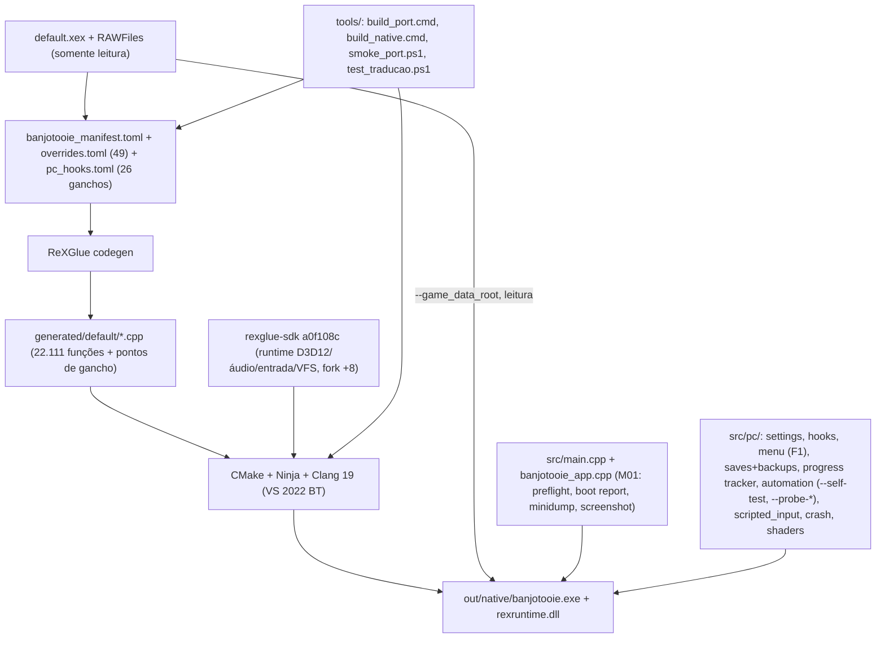

# Missão 00 — Auditoria do estado atual (revisão de 2026-11-11)

**Escopo:** inventário e linha de base do projeto já existente, sem implementar funcionalidades novas.
Os arquivos do jogo em `W:\Decomp\Banjo 3\Banjo Tooie BR` foram tratados como entrada somente leitura;
nenhuma operação Git remota foi feita nesta rodada. As alterações preexistentes não commitadas foram
**preservadas** (ver seção "Estado do Git").

## Resumo

O projeto contém: um port nativo Windows x86-64 por recompilação estática (ReXGlue), a partir do
`default.xex` fornecido pela pessoa; uma **camada de PC** importada do projeto irmão `W:\Decomp\Banjo`
(commit `58c7b75`), que entrega 4K, 60 FPS, distância de desenho, menu de configurações de PC, controle
e auto-teste; testes automatizados reais de jogabilidade (`--self-test`) que chegam ao **jogo livre**
sozinhos; tradução PT-BR conferida (Missão 02).

Nesta auditoria, **com execuções reais** do executável existente (`app/out/native/banjotooie.exe`):

- **auto-teste 10/10 em duas resoluções** (1080p e 4K): boot, janela, título → JOGAR → JOGO 1, pular
  cenas, jogo livre alcançado em ~25,5 s, movimento (719,8 unidades), pulo (112,3 unidades), HUD na
  tela de status, rastreador de colecionáveis, entrada "CONFIGURAÇÕES DE PC" abrindo o menu de PC;
- **4K medido**: imagem do jogo **3840×2160**; em jogo livre **59,8 quadros/s de lógica** e
  **60,0 apresentados/s**, frametime **16,70 ms ± 1,25 ms** (máx. 31,2 ms numa passada isolada);
- **saves observados**: durante a navegação o jogo criou save real no diretório de usuário isolado
  (`savegame.dat` + cabeçalho + **3 backups automáticos**);
- **36/36 arquivos do jogo intactos** antes e depois de todos os testes;
- dependências de build (VS 2022 Build Tools + Clang, CMake 4.4, Ninja 1.13) presentes.

Isso fecha as perguntas críticas que estavam abertas na auditoria anterior (4K/60 entregues; auto-teste
real de mover/agir/HUD; navegação automatizada até o jogo). O que **ficou pendente** está na matriz.

## Raízes, arquivos e ferramenta de build

- **Pasta Craft Anything:** `W:\Decomp\Banjo 3` — **Raiz Git e código:** `W:\Decomp\Banjo 3\app`
- **Dados fornecidos (somente leitura):** `W:\Decomp\Banjo 3\Banjo Tooie BR` — 36 arquivos
  (`default.xex`, `RAWFiles\...`, `ArcadeInfo.xml`, 25 PNGs). Hashes em `app/_audit/out/inventory.json`.
- **Executável:** `app\out\native\banjotooie.exe` (PE x86-64 nativo, 32.041.984 B) + `rexruntime.dll`
  (12.455.936 B, runtime ReXGlue). Laçador do Craft: `app\Build\banjotooie.exe`
  (`tools\native_launcher.cpp`) localiza o jogo em tempo de execução.
- **Build:** `tools\build_port.cmd all` (VS 2022 Build Tools, Clang 19, CMake 4.4, Ninja 1.13:
  build do gerador rexglue → `rexglue codegen` do XEX → jogo). O adaptador do Craft é
  `package.json` → `tools\build_native.cmd` (CMake/Ninja em `out\native`). O código recompilado
  gerado fica em `banjotooie-recomp\generated\default\*.cpp` (22.111 funções; não versionado).
- **Testes:** auto-teste embutido `--self-test <json>` e sondas `--probe-*` (camada de PC),
  `tools\smoke_port.ps1` (Missão 01) e `tools\test_traducao.ps1` (Missão 02).

## Estado do Git

- **HEAD:** branch `port-pc-4k60`, commit `58c7b75` "Port PC: camada de PC do projeto W:\Decomp\Banjo"
  — **9 commits à frente de `master`** (`1075821`). Branches: `missao-01-port-nativo` e
  `missao-02-traducao` em `f4aaeb0`/`4e61a64`.
- **Checkpoint seguro desta rodada:** `refs/checkpoints/missao-00-rodada6-20261111` → `58c7b75`
  (não destrutivo; não mexe em HEAD/índice). Diff da árvore suja arquivado em
  `app\_audit\out\m00-r6\trabalho_sujo.diff` (11.274 B; rolo de volta: aplicar a partir do checkpoint).
- **Este relatório foi commitado** no branch `port-pc-4k60` (ver `git log`; somente este arquivo;
  as mudanças preexistentes seguem fora do commit, preservadas).
- **Árvore de trabalho suja (preexistente, preservada):** `banjotooie-recomp\pc_hooks.toml`,
  `src\pc\pc_hooks.cpp` e `src\pc\pc_state.h` — reforma em andamento da entrada de PC no menu de pausa:
  em vez de renomear "CLASSIFICAÇÕES", **acrescenta** uma 7ª entrada "CONFIGURAÇÕES DE PC"
  (gancho novo `PcHook_PauseMenuBuilt` em `0x822DF120`). **Atenção:** esse gancho está no `.toml` e no
  código, mas **não** foi passado pelo codegen: `generated\default\*.cpp` contém 26 hooks da versão
  commitada, sem `PcHook_PauseMenuBuilt`. Quem for buildar a árvore suja precisa rodar
  `tools\build_port.cmd codegen` (ou `all`) **antes** — caso contrário o exe compila mas a entrada
  nova não é ligada. A evidência desta auditoria refere-se ao exe atual (build das 21:28 de
  2026-11-10, anterior à reforma).
- **Submódulo `rexglue-sdk`:** em `a0f108c` (= fork iron-jay `035aa25`, tag `v0.8.0-5`, + **8 commits**
  do branch local `ptbr-port-banjo3`: gamepad, volume, ritmo de apresentação a 60, VBlank com timer,
  midasm com `lr`, bloqueio de entrada durante o menu de PC, controle virtual SDL, fila de teclas).
  Sub-submódulos `thirdparty\libmspack` e `o1heap` aparecem com conteúdo alterado (materialização de
  links simbólicos, `tools\materialize_symlinks.py`; pré-existente).
- **Não rastreados (não adicionados nem apagados):** `.understory-project-id`, `.understory\`,
  `docs\evidencias\m00-atual-20261110\` (contém conteúdo do jogo — não commitar).
- `git remote -v` vazio; **nenhun acesso remoto nesta rodada** (decisão do projeto; ver Limitações).

## Comparação com a base principal (referências locais)

Referências locais (snapshot de 2026-11-09, `docs\evidencias\upstream_heads.log`): base
`iron-jay/banjo_tooie_xbla_recomp` @ `72c2397`; fork `iron-jay/rexglue-sdk` @ `035aa25`;
`rexglue/rexglue-sdk` @ `546a082`; `hedge-dev/XenonRecomp` @ `ddd128b`; `sonicnext-dev/XenonRecomp`
@ `e146930`; `XenonRecompUnlimited` @ `be92e99`; `MC_LA_Recompiled` @ `fa66dd8`.
O port local diverge da base em: `src\pc\` (camada de PC), `pc_hooks.toml` (26 ganchos),
overrides (+1 endereço `0x822479EC`, total 49, conferido 49/49 na Missão 01), e no SDK (8 commits).
A ponte gráfica/console é o **runtime ReXGlue** (D3D12 no Windows, preset `4k`/escala), não o
XenonRecomp isolado (que não traz runtime). **Atualidade dos remotos: PENDENTE** — sem operação remota
permitida nesta rodada; os valores acima são o snapshot local já guardado.

## Mapa dos módulos

## Testes e evidências desta rodada (execuções reais)

Saídas em `app\_audit\out\m00-r6\` (não versionado). Usuário/cache **isolados** em
`m00-r6\user` e `m00-r6\cache`; nada tocou os dados do jogo nem os saves reais da pessoa.

| Verificação | Resultado observado | Evidência |
|---|---|---|
| Integridade dos 36 arquivos do jogo (antes) | **36/36 ok**, 0 diferenças | `m00-r6\game_integrity_before.json` |
| Boot + pré-flight | preflight PASS (obrigatórios/recomendados presentes; `db360_TexFileList.txt` ausente e opcional), XEX carregado, primeiro quadro a 0,20 s | `m00-r6\boot.json` |
| Auto-teste (1080p, automático) | **10/10 passos**: boot, render, navigate (título→JOGAR→JOGO 1→cenas puladas→jogo livre@25,6 s), move (719,8 u), act (pulo 112,3 u), fps (60,0/60,0), frame_pacing (16,65 ms ±0,90), hud, tracker, pcmenu | `m00-r6\self_test.json` |
| Auto-teste (4K, configuração do perfil de teste) | **10/10 passos**; render **3840×2160**; fps 59,8 lógica / 60,0 apresentados; frametime 16,70 ms ±1,25 ms; pcmenu abre o menu de PC pelo menu de pausa | `m00-r6\self_test_4k.json`, `boot4k.json` (`pc_video: 4k escala 3x fps60=true`) |
| Captura de tela (`--screenshot`) | PNG 3840×2160 (24,9 MB), imagem com conteúdo (não vazia) | `m00-r6\capture_4k.png` |
| Saves | jogo criou `savegame.dat` (3.072 B) + `.header` + 3 backups automáticos + `backups.log` no perfil isolado | `m00-r6\user\B13EBABEBABEBABE\...` |
| Integridade dos 36 arquivos do jogo (depois) | **36/36 ok**, 0 diferenças | `m00-r6\game_integrity_after.json` |
| Executável | PE x86-64 nativo, entry point `0x141d41fa4` (Windows) | inventário do Craft (`core_target_triage`) |
| Git | checkpoint `refs/checkpoints/missao-00-rodada6-20261111`; diff sujo arquivado; hashes do exe/dll registrados | `m00-r6\trabalho_sujo.diff`, `exe_hashes_before.json` |

Nota de medição: 4K/60 medidos na RTX 5080 com monitor 3840×2160@60. A auto-detecção de resolução
escolheu 1080p numa primeira execução porque `EnumDisplaySettingsW` reportou a tela Intel
(2560×1080); forçar `resolution="2160p"` no perfil de teste rendeu o modo 4K sem problema
(melhorar a auto-detecção é candidato a QoL, não bloqueio).

## Matriz de requisitos (estado atual com evidência)

| Requisito | Estado | O que a evidência permite afirmar |
|---|---|---|
| Port nativo Windows x64 | **IMPLEMENTADO** | exe PE x86-64 roda sem emulador; naviga até o jogo livre com entrada sintética |
| 4K (3840×2160) | **IMPLEMENTADO** | self-test renderiza 3840×2160 e passa 10/10; captura 4K com conteúdo |
| 60 FPS | **IMPLEMENTADO** | jogo livre: 59,8 fps de lógica e 60,0 apresentados, frametime 16,70 ±1,25 ms (com opções padrão da camada de PC: fps60+lock60) |
| Menu START (menu do jogo) | **IMPLEMENTADO** | navegação automatizada título→JOGAR→JOGO 1→cenas→jogo; pausa (START) e entrada de PC funcionam; + relato da pessoa (DECISOES nº1) |
| PT-BR | **PARCIAL** | telas de abertura/menus conferidas na Missão 02 (15/15); cobertura integral de HUD/diálogos continua em investigação (unk_a86c90) |
| Draw distance | **PARCIAL** | ganchos e 3 perfis (Original/Longe/Total) no código e no build, com sondas `--probe-dd*`; comparação visual dos 3 perfis não executada nesta rodada |
| Gamepad | **PARCIAL** | entrada virtual (SDL) conduz o jogo real no self-test; gamepad físico (XInput) não conectado/testado nesta rodada |
| Saves | **IMPLEMENTADO (gravação+backup) / PARCIAL (carga)** | save real criado + 3 backups observados; roundtrip de carregar esse save pelo menu ainda não automatizado (sondas `--make-advanced-save`/`--probe-advanced-save` existem) |
| QoL | **IMPLEMENTADO (conjunto inicial)** | menu de PC com 60 FPS/cenas, velocidade de diálogos, início rápido, contador de FPS/perf, pausa ao perder foco, backups de save, câmera/controle sensíveis |

## Ordem de implementação recomendada (próximas missões)

1. **Fechar a reforma em andamento do menu de pausa** (já escrita na árvore de trabalho):
   `tools\build_port.cmd codegen` + rebuild + rodar o auto-teste; o gancho `PcHook_PauseMenuBuilt`
   precisa do codegen para ser ligado, e o passo `pcmenu` do auto-teste foi feito para a versão
   atual (renome). Sem isso, qualquer build da árvore suja perde a entrada de PC.
2. **Roundtrip de saves automatizado** (`--make-advanced-save` + `--probe-advanced-save` em perfil de
   teste), para provar carga além da gravação já observada.
3. **Validação visual de draw distance** (`--probe-drawdistance`/`--probe-dd-worlds`) nos 3 perfis,
   com capturas e medir impacto no FPS.
4. **Gamepad físico**: rodar `--probe-gamepad`/`--probe-testpad` com um controle XInput conectado.
5. **Cobertura PT-BR no HUD/diálogos do jogo** (continuação da Missão 02; hoje abertura, menus,
   pausa, submenus, mensagem do sistema e fala do Bottles conferidas).
6. **Regressão completa** (`tools\smoke_port.ps1` + `tools\test_traducao.ps1`) depois que a camada de
   PC sair da árvore suja, antes de considerar a linha de base fechada em master.

## Comandos executados nesta rodada

- `git -C app status/log/branch/submodule`, `git update-ref refs/checkpoints/missao-00-rodada6-20261111 HEAD`,
  `git -C app diff > _audit\out\m00-r6\trabalho_sujo.diff` (locais, sem rede).
- Conferência de integridade 36/36 com Node antes/depois (SHA-256 contra `_audit\out\inventory.json`).
- `banjotooie.exe --game_data_root "W:\Decomp\Banjo 3\Banjo Tooie BR" --user_data_root ...\m00-r6\user
  --cache_path ...\m00-r6\cache --audio_mute --log_file ... --boot_report ... --self-test <json>
  --background_window --port_silent` — duas vezes (perfil 1080p e perfil com `resolution="2160p"`).
- `banjotooie.exe --screenshot ...\capture_4k.png --screenshot_seconds 12 ...` (captura 4K).
- `Get-FileHash` dos exes; `core_target_triage` e inventário via Craft Anything.
- `git -C app\rexglue-sdk describe/log` (linhagem do submódulo: `v0.8.0-5-g035aa25` → +8 commits).

## Riscos e pendências

- **Árvore suja com reforma parcial** (entrada de PC do menu de pausa): build sem codegen liga só
  metade da mudança. Nada foi alterado nesta rodada; o rollback é o checkpoint + diff arquivado.
- **Atualidade do upstream: PENDENTE** — comparação usa snapshot local de 2026-11-09, sem consulta
  remota (regra desta rodada).
- **PENDENTES da matriz:** carga de save automatizada, draw distance validado visualmente, gamepad
  físico com XInput, cobertura PT-BR no HUD/diálogos.
- **BLOQUEADO (não bloqueante):** `rebuild_check` do Craft achou "Unity" na raiz do workspace em
  rodadas anteriores; o projeto é C++/CMake nativo com `--self-test` real — não foi criado projeto
  Unity (seria fora do escopo).
- As duas pastas de build compartilham `rexglue-sdk\out\win-amd64\rexruntime.dll` (hash muda a cada
  religação); para comparar binários entre missões, usar uma pasta de build só.
- `docs\evidencias\m00-atual-20261110\` (não rastreado) contém conteúdo do jogo: não commitar/apagar.

## Resultado da missão

**PASS — auditoria e linha de base revalidadas em 2026-11-11, sem funcionalidades novas.** 4K/60,
auto-teste de jogabilidade, saves e navegação foram comprovados por execução real; PT-BR segue coberto
pelas evidências da Missão 02 para as telas conferidas. Nenhuma missão seguinte foi iniciada.